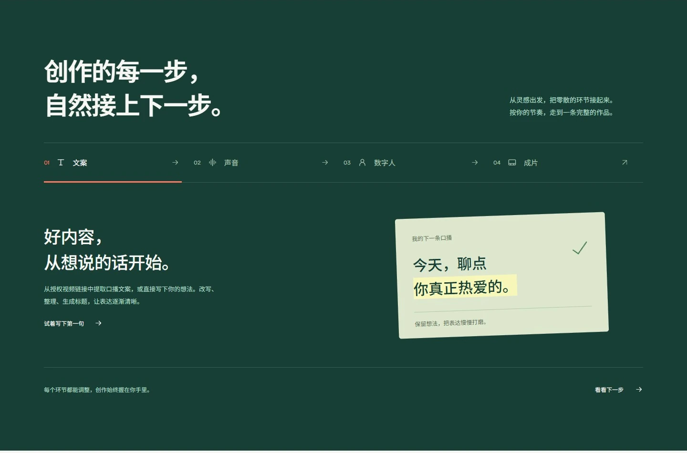
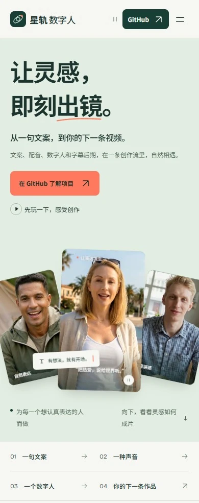
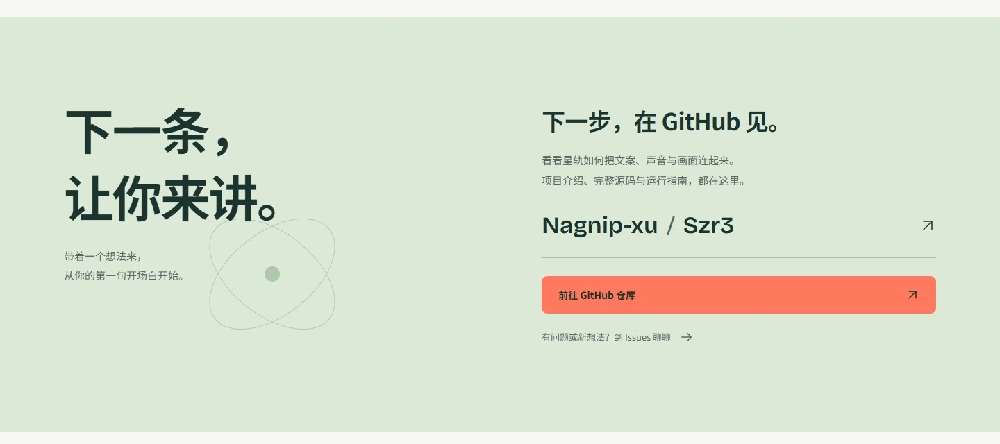
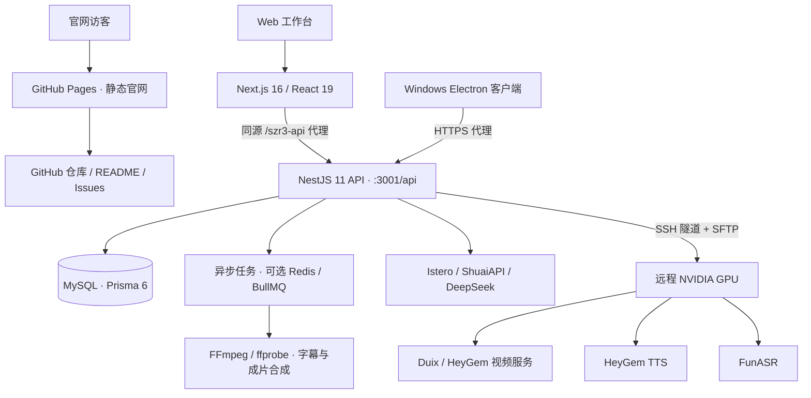

<div align="center">


# 星轨数字人 · XINGGUI

**让灵感，即刻出镜。**

从一句文案，到你的下一条视频。  
中文 AI 口播创作工作台 · Windows 桌面客户端 · 独立互动官网

[](https://nagnip-xu.github.io/Szr3/)
[](https://nodejs.org/)
[](#文档导航)
[](https://github.com/Nagnip-xu/Szr3/actions/workflows/pages.yml)

[访问官网](https://nagnip-xu.github.io/Szr3/) · [快速开始](#快速开始) · [功能一览](#功能一览) · [提交问题](https://github.com/Nagnip-xu/Szr3/issues)

</div>


> **访问说明**：GitHub Pages 提供产品介绍和可交互的参考演示，主要按钮直接打开本仓库。实际配音、声音克隆、数字人生成和成片渲染需要单独部署 API、数据库与 GPU 服务。

## 目录

- [项目简介](#项目简介)
- [界面预览](#界面预览)
- [功能一览](#功能一览)
- [技术架构](#技术架构)
- [快速开始](#快速开始)
- [环境配置](#环境配置)
- [GitHub Pages 部署](#github-pages-部署)
- [Windows 桌面端](#windows-桌面端)
- [测试与验证](#测试与验证)
- [项目目录](#项目目录)
- [常见问题](#常见问题)
- [文档导航](#文档导航)
- [素材与使用说明](#素材与使用说明)

## 项目简介

星轨数字人面向知识分享、自媒体口播与产品介绍等中文内容创作场景，把文案整理、声音制作、数字人口型驱动和视频后期连接在一个工作台里。

典型流程：**授权视频链接 / 原创文案 → 提取与改写 → 配音 → 数字人 → 字幕、配乐、画中画与封面 → MP4 导出**。

仓库包含四个可以分别理解、运行和部署的部分：

| 部分           | 目录                           | 作用                                                  | 运行依赖                                 |
| -------------- | ------------------------------ | ----------------------------------------------------- | ---------------------------------------- |
| 互动官网       | [`website/`](website/)         | 产品介绍、人物参考播放、实时字幕样式、GitHub 项目入口 | 静态 HTTP 服务；无需生产依赖             |
| Web 工作台     | [`web/`](web/)                 | 用户登录、创作流程、项目管理和管理员界面              | Node.js、API                             |
| API 服务       | [`api/`](api/)                 | 认证、组织、素材、任务、第三方模型与 GPU 调用         | Node.js、MySQL、FFmpeg；生成任务需要 GPU |
| Windows 客户端 | [`desktop-exe/`](desktop-exe/) | Electron 桌面体验、系统下载与 HTTPS API 代理          | 用户使用时需要 Windows 和可用的服务端    |

## 界面预览

### 可编辑的口播参考演示

输入字幕后立即显示在参考画面上；可以切换三个人物、三种字幕样式，播放、暂停或拖动真实视频进度。画面来自项目现有预设素材，**不是官网实时生成的数字人结果**。


### 从文案到成片的流程讲解

四个步骤可以来回切换，也支持键盘方向键导航。动效用于保持状态与画面的连续关系。



<table>
<tr>
<td width="34%" valign="top" align="center">
<strong>移动端首页</strong><br /><br />

</td>
<td width="66%" valign="top">
<strong>下一步，在 GitHub 见</strong><br /><br />
官网保留产品探索与互动演示；页首、主按钮和页面底部直接跳转 GitHub 仓库。问题与建议通过 Issues 交流，无需在官网填写邮箱。<br /><br />

<br /><br />
<strong>视觉语言</strong><br />
日光白、浅薄荷、深松绿与珊瑚色按钮，搭配本地字体、真实人物参考片段和轻量动效。支持键盘、移动布局、自动动效暂停与系统“减少动态效果”。
</td>
</tr>
</table>

截图由本仓库官网实际渲染后截取。设计规范见 [`website/DESIGN.md`](website/DESIGN.md)。

## 功能一览

“已接入”表示仓库存在对应实现和调用链，不代表无需配置即可使用，也不代表当前远程服务持续在线。

| 阶段   | 能力                   | 当前实现                                                  |
| ------ | ---------------------- | --------------------------------------------------------- |
| 文案   | 授权链接解析与口播提取 | Istero Video Parser V2 + FunASR 分段 / 时间戳             |
| 文案   | 改写、标题与话题生成   | ShuaiAPI 兼容接口调用 DeepSeek                            |
| 文案   | 内容审查               | 后端规则检查与风险词替换建议                              |
| 声音   | TTS 配音与语速设置     | GPU HeyGem TTS                                            |
| 声音   | 授权音色克隆           | 参考音频预处理与自定义音色记录                            |
| 数字人 | 预设人物与自定义形象   | 三个预设参考人物；组织级自定义数字人                      |
| 数字人 | 口型驱动视频           | Duix-Avatar / HeyGem 远程生成                             |
| 后期   | 字幕与样式预览         | 浏览器预览、ASS 字幕、FFmpeg 烧录                         |
| 后期   | BGM 与画中画           | FFmpeg 混音与合成任务                                     |
| 后期   | 封面                   | 已有接口与状态；需按实际素材验收完整效果                  |
| 导出   | MP4 渲染与下载         | 异步 RenderJob、进度轮询、受保护的文件下载                |
| 管理   | 登录、注册码与组织隔离 | JWT、一次性注册码、组织级项目 / 素材                      |
| 管理   | 管理员后台             | 独立管理员登录、统计与注册码管理                          |
| 存储   | 项目状态与草稿         | MySQL / Prisma 持久化，浏览器草稿兜底                     |
| 任务   | 后台处理               | 可选 Redis / BullMQ；未配置 Redis 时使用进程内异步 Worker |

当前边界：

- **多平台自动发布尚未接入**：成片由用户下载后自行发布。
- 完整模板库与一键自动编排尚未形成完整的后端编排能力。
- 官网参考演示不会调用在线 GPU，也不会收集或提交申请表。
- 模型权重、GPU 容器镜像与 FFmpeg 二进制不随源码上传。

## 技术架构



| 层     | 技术                                                                       |
| ------ | -------------------------------------------------------------------------- |
| 官网   | 原生 HTML / CSS / JavaScript、Web Animations API、本地 WOFF2 与 MP4 / WebP |
| 工作台 | Next.js 16.3.1、React 19、TypeScript、Tailwind CSS 4、Lucide               |
| API    | NestJS 11、TypeScript、JWT、class-validator                                |
| 数据   | MySQL、Prisma 6；项目状态与生成任务持久化                                  |
| 媒体   | FFmpeg、ASS 字幕、视频 Range 请求、SFTP 素材传输                           |
| 桌面端 | Electron 37、electron-builder 26、Windows NSIS                             |
| 发布   | GitHub Actions → Pages Artifact → GitHub Pages                             |

## 快速开始

### 只查看官网

无需数据库、GPU 或 npm 依赖安装。安装 Node.js 20.9+ 后：

```powershell
git clone https://github.com/Nagnip-xu/Szr3.git
cd Szr3
npm run dev:website
```

访问 **<http://127.0.0.1:4175>**。也可以直接访问 [在线官网](https://nagnip-xu.github.io/Szr3/)。

### 运行完整工作台

当前开发脚本以 **Windows PowerShell** 为主，尤其管理员实例和 Electron 构建脚本。API 可单独部署到 Linux；跨平台使用时请调整 Windows 专用命令。

前置环境：Node.js **20.9+**（建议 22 LTS）、npm、MySQL 8、FFmpeg / ffprobe。配音、识别与数字人生成功能还需要可访问的 GPU 容器服务；文案解析和改写需要对应第三方服务配置。

**1. 安装依赖**

```powershell
npm install
npm run install:all
```

根目录不是 npm workspace；`install:all` 会分别安装 `web/` 和 `api/` 的依赖。桌面端依赖单独安装。

**2. 准备配置与数据库**

```powershell
Copy-Item api/.env.example api/.env
# 编辑 api/.env，设置数据库连接、JWT_SECRET 和所需服务参数

docker compose -f docker-compose.mysql.yml up -d mysql
cd api
npm run db:generate
npm run db:push
npm run db:seed
cd ..
```

Docker Compose 是本地开发数据库示例，默认密码与模板值不同；请先使 `api/.env` 的 `DATABASE_URL` 与实际 MySQL 配置一致。`db:push` 会调整表结构，只用于已确认的开发数据库。

开发种子创建的演示账号仅用于本地验证，见 [`api/prisma/seed.ts`](api/prisma/seed.ts)。管理员后台需要角色为 `super_admin` 的账号，演示账号不具备该权限。

**3. 在 API 终端加载环境变量并启动**

NestJS 入口当前不会自动读取 `.env`，可以通过 Node 的 `--env-file` 显式加载：

```powershell
cd api
npm run build
node --env-file=.env dist/src/main.js
```

修改后端代码后，重新构建并重启该进程。开发监控模式也应由启动环境显式提供 `.env` 中的变量。

**4. 在新的终端启动工作台**

```powershell
cd web
npm run dev
```

可选：再开一个终端运行 `npm run dev:admin`。此命令使用 Windows 的环境变量语法。

| 地址                                     | 用途                            |
| ---------------------------------------- | ------------------------------- |
| `http://127.0.0.1:3000`                  | Web 创作工作台                  |
| `http://127.0.0.1:3001/api/health`       | API 与数据库存活检查            |
| `http://127.0.0.1:3001/api/health/ready` | 数据库、视频与 TTS 服务就绪检查 |
| `http://127.0.0.1:3002/admin/login`      | 独立管理员实例                  |

浏览器固定请求同源 `/szr3-api`，由 Next.js 转发到 API；后端目标通过 **服务端变量 `SZR3_API_PROXY`** 覆盖，默认 `http://127.0.0.1:3001/api`。不要把密钥放入 `NEXT_PUBLIC_*`。

**5. 按需创建平台管理员**

在 `api/` 中配置一次性的管理员邮箱和强密码后运行：

```powershell
$env:ADMIN_EMAIL = "admin@example.com"
$env:ADMIN_PASSWORD = "请替换为独立强密码"
node --env-file=.env scripts/bootstrap-production-admin.mjs
Remove-Item Env:ADMIN_PASSWORD
```

使用管理员登录页进入后台，创建普通用户注册所需的一次性注册码。

## 环境配置

真实配置存放在本机或服务器的 `api/.env`，模板见 [`api/.env.example`](api/.env.example)。仓库只保留示例，不包含真实配置、用户媒体和数据库。

| 类别       | 变量                                                                                      | 作用                          |
| ---------- | ----------------------------------------------------------------------------------------- | ----------------------------- |
| 数据与认证 | `DATABASE_URL`、`JWT_SECRET`、`PORT`                                                      | MySQL、JWT 签名与 API 端口    |
| HTTP       | `CORS_ORIGIN`、`API_PUBLIC_URL`                                                           | 允许来源与媒体 URL 基址       |
| 文件       | `STORAGE_ROOT`、`MEDIA_RETENTION_DAYS`                                                    | 存储位置和保留策略            |
| 链接解析   | `ISTERO_API_TOKEN`、`ISTERO_APP_SECRET`                                                   | 授权视频链接解析              |
| 文本模型   | `SHUAIAPI_BASE_URL`、`SHUAIAPI_API_KEY`、`SHUAIAPI_LLM_MODEL`                             | 改写、标题和话题              |
| GPU        | `DUIX_VIDEO_API`、`DUIX_TTS_API`、`DUIX_ASR_WS`                                           | 视频、配音与识别服务          |
| SSH        | `DUIX_USE_SSH_TUNNEL`、`GPU_SSH_HOST`、`GPU_SSH_PORT`、`GPU_SSH_USER`、`GPU_SSH_PASSWORD` | GPU SSH 隧道与传输            |
| 隧道端口   | `DUIX_TUNNEL_VIDEO_PORT`、`DUIX_TUNNEL_TTS_PORT`、`DUIX_TUNNEL_ASR_PORT`                  | 本地服务映射                  |
| 后期       | `FFMPEG_PATH`、`FFPROBE_PATH`                                                             | 可执行程序路径；也可使用 PATH |
| 可选服务   | `REDIS_URL`、`VIRUS_SCAN_ENABLED`、`CLAMAV_HOST`、`CLAMAV_PORT`                           | 队列与病毒扫描                |

默认映射：视频 `18383 → 8383`、TTS `18181 → 18180`、ASR `10096 → 10095`。GPU 容器端口应在受控网络内，通过 SSH 隧道访问。

工作流接口通常返回 `jobId`，需轮询 `/api/workflow/jobs/:jobId`。提交任务成功并不等于视频已经生成完成。完整接口列表见 [API 接口参考](docs/api-reference.md)。

## GitHub Pages 部署

**官网地址：[https://nagnip-xu.github.io/Szr3/](https://nagnip-xu.github.io/Szr3/)**

发布工作流位于 [`.github/workflows/pages.yml`](.github/workflows/pages.yml)。推送到 `main` 且修改 `website/`、打包脚本或工作流时自动发布，也可以在 Actions 中手动运行。

```text
website/ 中的公共页面与素材
          ↓ node scripts/build-website.mjs
_site/（页面、样式、脚本、公共 assets、.nojekyll）
          ↓ upload-pages-artifact
GitHub Pages
```

打包步骤采用明确的文件范围，只复制官网 HTML / CSS / JS 与公共素材，不上传后端、`.env`、设计审查工具或业务数据库。资源使用相对路径，支持 `/Szr3/` 仓库子路径，无需自定义域名。

本地检查发布产物：

```powershell
npm run build:website
```

脚本要求 `_site/` 为空，避免把旧发布文件混入本次产物；重建前清理该生成目录。新仓库首次部署还需在 **Settings → Pages → Source** 选择 **GitHub Actions**。本仓库已配置对应工作流。

官网内容维护见 [`website/README.md`](website/README.md)。中文文案改变后，运行 `node website/tools/fetch-font.mjs` 重新生成本地字体子集。

## Windows 桌面端

客户端构建时复制 `web/` 到自身 `build/`，再应用 `overrides/`，不会改写 Web 源码。

```powershell
cd desktop-exe
npm install
npm run dist
```

当前源码版本 **1.0.7**；`dist` 会先递增版本号，再构建前端和 NSIS 安装包。安装包输出为 `desktop-exe/dist/Szr3-Setup-<version>.exe`。仓库不包含本机旧安装包，也不把安装包上传到 Pages。

用户端需要 Windows 10/11 x64 与可用网络，无需安装 Node.js / MySQL / FFmpeg。默认连接地址见客户端源码和 [桌面端说明](desktop-exe/README.md)；实际使用仍依赖服务端 HTTPS、认证、GPU 与业务环境。

## 测试与验证

2026-11-22 本地验证记录：

| 检查                                    | 结果与范围                                                                                    |
| --------------------------------------- | --------------------------------------------------------------------------------------------- |
| API：`npm test --prefix api`            | **10 项通过**：隧道重连、端口恢复、就绪判断、路径与地址检查                                   |
| 桌面端：`npm test --prefix desktop-exe` | **4 项通过**：可信 HTTPS 转发与过期 / 不可信 / 域名不匹配证书拒绝                             |
| 工作台：`npm run lint --prefix web`     | 通过                                                                                          |
| 工作台：`npm run build --prefix web`    | 通过生产构建与 TypeScript 检查                                                                |
| 官网打包：`npm run build:website`       | 通过；所有本地资源引用存在                                                                    |
| 官网浏览器验证                          | 320 / 360 / 390 / 768 / 1024 / 1440px，字幕、人物、播放、流程、FAQ、GitHub 入口与减少动态效果 |
| 官网可访问性扫描                        | 桌面与手机视口的 Axe WCAG A / AA / 2.1 AA 扫描无违规项；不替代完整人工审计                    |

这些检查不代表真实 GPU 已完成端到端生成验收。已有服务器连接问题与待恢复事项记录在 [运行故障排查](docs/2026-11-22-run-diagnostics.md)，该记录描述当时状态，不代表 GitHub Pages 的运行状态。

## 项目目录

```text
Szr3/
├─ .github/workflows/pages.yml   官网自动发布
├─ api/
│  ├─ src/                      认证、组织、项目、素材、媒体、任务与集成
│  ├─ prisma/                   MySQL 数据模型与开发种子
│  ├─ test/                     API 回归测试
│  └─ scripts/                  引导、诊断与部署脚本
├─ web/
│  └─ src/                      Next.js 页面、创作组件、状态与 API 客户端
├─ desktop-exe/
│  ├─ src/                      Electron 主进程与 HTTPS 代理
│  ├─ overrides/                桌面端专用覆盖层
│  └─ test/                     HTTPS 测试与本地证书夹具
├─ website/                     独立官网、公共素材与设计规范
├─ docs/                        接口、运维、部署、条款与截图
├─ scripts/                     官网打包、FFmpeg 准备等辅助脚本
├─ docker-compose.mysql.yml     本地 MySQL 与可选 ClamAV
├─ package.json                 多服务开发和官网命令
└─ README.md
```

`node_modules/`、构建产物、运行媒体、数据库、真实 `.env` 和本机诊断缓存均被忽略。桌面 HTTPS 测试使用的证书夹具只供本地回归测试，不是服务端身份凭据。

## 常见问题

<details>
<summary><strong>官网能直接生成数字人吗？</strong></summary>

不能。官网提供参考人物播放、字幕编辑与产品流程讲解。真实生成在工作台调用服务端 API，再由 GPU 处理。

</details>

<details>
<summary><strong>为什么官网按钮直接打开 GitHub？</strong></summary>

官网用于介绍项目和展示交互。源码、运行指南、功能状态与反馈统一在本仓库，不需要填写申请表。

</details>

<details>
<summary><strong>API 的 health 正常，为什么生成仍然失败？</strong></summary>

`/api/health` 只检查进程与数据库。`/api/health/ready` 还会检查视频和 TTS 服务；ASR、第三方接口、参考素材、权限和实际渲染链路仍需分别验证。

</details>

<details>
<summary><strong>复制 .env 后为什么启动仍然缺少配置？</strong></summary>

API 入口当前不会自动加载文件。使用 `node --env-file=.env dist/src/main.js`，或由进程管理器注入变量；Prisma CLI 的 `.env` 加载行为与服务启动不同。

</details>

<details>
<summary><strong>桌面端无法登录或者提示证书过期？</strong></summary>

在 `desktop-exe/` 运行 `npm run check:connection`，根据返回检查服务端 HTTPS、API 和 GPU。保留 TLS 校验，证书恢复操作见运维文档。

</details>

<details>
<summary><strong>为什么不能从普通用户页面登录平台管理员？</strong></summary>

平台管理员使用独立登录入口，要求 `super_admin` 角色。普通用户注册需要有效且未使用的一次性注册码。

</details>

<details>
<summary><strong>能否一键自动发布到抖音或视频号？</strong></summary>

当前没有接入多平台 OAuth 和自动发布。可以编辑发布资料、导出 MP4，再自行上传到目标平台。

</details>

## 文档导航

| 文档                                               | 内容                                       |
| -------------------------------------------------- | ------------------------------------------ |
| [官网维护](website/README.md)                      | 本地预览、互动、字体和静态发布             |
| [官网设计规范](website/DESIGN.md)                  | 色彩、排版、布局、组件与动效               |
| [API 接口参考](docs/api-reference.md)              | 健康、认证、工作流、项目、素材和下载接口   |
| [运行与部署](docs/operations.md)                   | 数据库、GPU、服务部署和 HTTPS 修复         |
| [Duix GPU 部署](docs/duix-avatar-deploy.md)        | 远程推理环境准备                           |
| [运行故障排查](docs/2026-11-22-run-diagnostics.md) | 已定位问题、验证范围与待恢复事项           |
| [模块接入状态](docs/模块接入状态.md)               | 原有模块接入说明，实际实现以源码和本文为准 |
| [桌面端说明](desktop-exe/README.md)                | 桌面覆盖层、构建和交付                     |
| [使用条款](docs/terms-of-service.md)               | 授权、数字人与内容使用约定                 |

## 素材与使用说明

- 人物参考片段沿用本项目预设素材，来源和加工方式见 [`website/assets/README.md`](website/assets/README.md)。它们不构成用户可以任意商用第三方肖像的授权。
- Noto Sans SC 与 Bricolage Grotesque 字体使用 SIL Open Font License，许可证文本随字体保留。
- Duix / HeyGem、Fish-Speech、FunASR、FFmpeg 与第三方 API 的许可证及商业条款需要分别核对，不能以本仓库公开替代上游授权。
- 本仓库暂未附项目级开源许可证；如需分发、修改后发布或商业使用，请先与仓库作者确认授权范围。
- 克隆声音、使用肖像、解析外部视频前应取得相应授权。问题或建议请提交 [Issues](https://github.com/Nagnip-xu/Szr3/issues)。

---

<div align="center">

**从一句文案，到你的下一条视频。**

[访问星轨官网](https://nagnip-xu.github.io/Szr3/) · [回到顶部](#星轨数字人--xinggui)

</div>
